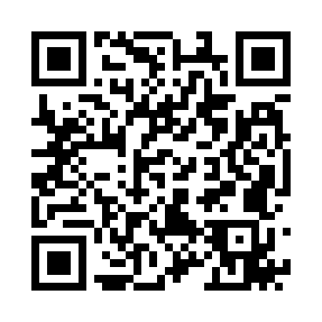
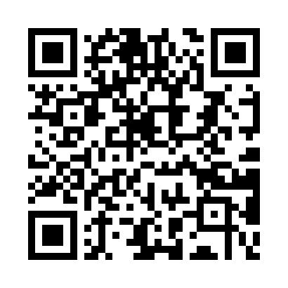
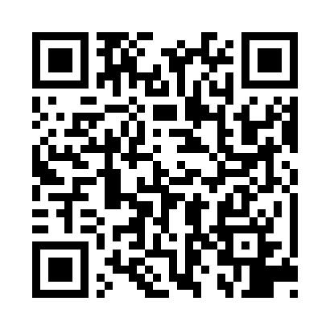

# 投射シミュレーション（projectile-board）

授業で黒板・スクリーンに大きく映して使う、水平投射・斜方投射のシミュレーション。ライブラリなしの静的サイト。

## 公開ページ

| ページ | リンク | QR コード |
|---|---|---|
| トップ（メニュー） | https://phys-ken.github.io/projectile-board/ |  |
| 水平投射 | https://phys-ken.github.io/projectile-board/suihei.html |  |
| 斜方投射 | https://phys-ken.github.io/projectile-board/shaho.html |  |

QR コードの画像は `img/` にある（PNG と SVG）。

## 中身

- **水平投射** `suihei.html`：初速度のちがう球を最大 5 個同時に投げる。自由落下（v₀＝0）も入れて、落下時間が同じことを見る。高さ H も変えられる。
- **斜方投射** `shaho.html`：初速度 v₀・角度 θ・初めの高さ h₀ を変える。最高点 P・着地点 Q、角度くらべ（15°〜75°）。

## 使い方

- 画面いっぱいがキャンバス。操作は下のボタンの列：▶ 再生、◀ コマ／コマ ▶（コマ送り）、⟲ リセット、ストロボ、ベクトル、グリッド。
- ⚙ 設定：初速度などのスライダー、時刻のスライダー、表示の切り替え（数値表示、軸への影、ストロボ位置にもベクトル、くり返し、黒板／白）。
- ▼ でボタンの列を小さくたたみ、▲ で戻す。投影中に画面を広く使える。
- ⛶ 全画面：パソコン・iPad・Android のブラウザでは全画面になる。iPhone の Safari は全画面に対応していないので、「共有 → ホーム画面に追加」で開くと、アドレスバーなしで表示できる。
- 黒板／白：背景の色を切り替える（黒板に映すときは黒板、プリントの図に使うときは白）。
